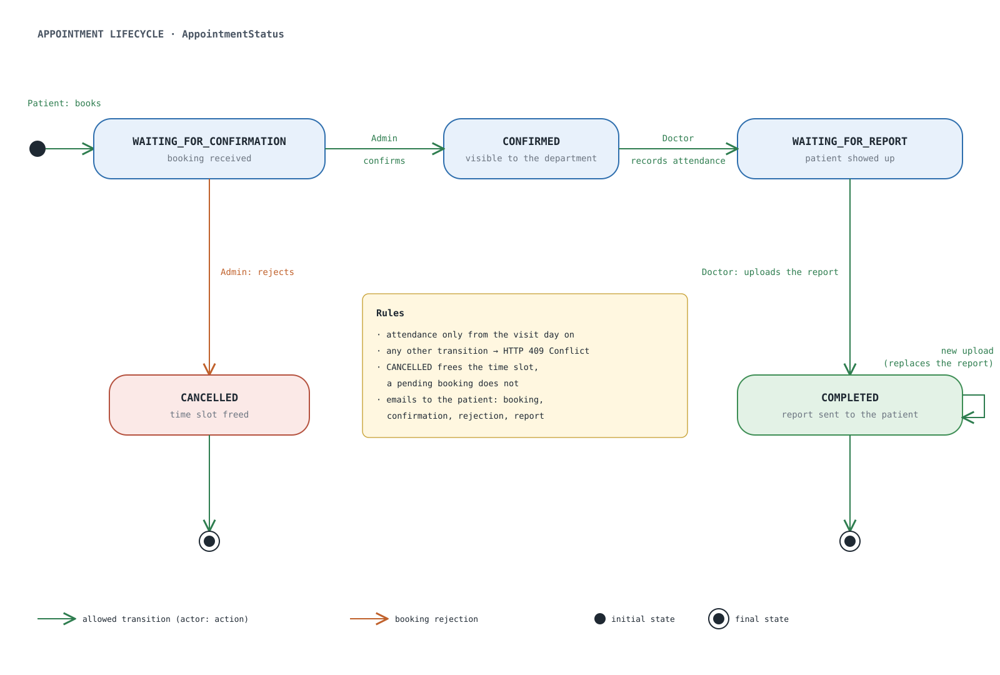

# Medical Center

A web app for booking visits at a medical center. Patients book online without an account, the admin staff confirms the bookings, and doctors upload the reports. The patient then downloads the report from a link sent by email.

Thesis project - Computer Science, Università Telematica Pegaso - Christian Esposito

## Technologies

Java 25, Spring Boot 4, React 19 + Vite, PostgreSQL 16, Docker Compose.

## Features

Patient
- books a visit by choosing department, day and time
- gets an email when the booking is received, and another when it is confirmed or rejected
- downloads the report from the email link, entering their tax code

Admin
- confirms or rejects bookings
- registers doctors and can disable or re-enable them
- manages departments (opening hours, visit length, open days)
- sees statistics and can resend report links

Doctor
- sees the upcoming and past visits of their department
- records that the patient showed up
- uploads the report as a PDF, and the patient gets an email right away

## Appointment lifecycle



A rejected booking frees its time slot for other patients.

## Project structure

- `backend/` - Spring Boot REST API
- `frontend/` - React app (pages, components, API calls)
- `db/init/` - database schema and demo data

The backend code is split into modules:

- `appointment` - departments, time slots and bookings
- `patient` - patient data
- `report` - report upload and download
- `staff` - doctor features
- `admin` - admin features and statistics
- `auth` - login and registration
- `core` - shared config, errors and emails

## How to run it

You need Docker with Docker Compose.

```bash
cp .env.example .env (the example values already work for the demo)
```

Fill in `DB_USER`, `DB_PASSWORD`, `DB_NAME` and `JWT_SECRET` in `.env` (the secret must be at least 32 characters). The `SPRING_MAIL_*` values are optional: without them the app works but sends no emails.

```bash
docker compose up -d --build
```

- Frontend: http://localhost:5173
- Backend: http://localhost:8080/api/v1
- PostgreSQL: localhost:9999

On first start the database is filled with the demo data from `db/init/init.sql`. To start again from an empty database:

```bash
docker compose down -v && docker compose up -d --build
```

## Demo accounts

All accounts use the password **Password123!**

| Role | Email | Department |
|---|---|---|
| Admin | admin@example.com | - |
| Admin | segreteria@example.com | - |
| Doctor | laura.bianchi@example.com | Cardiology |
| Doctor | giorgio.ferri@example.com | Dermatology |
| Doctor | paolo.ricci@example.com | Blood tests |
| Doctor | sara.colombo@example.com | Radiology |
| Doctor | francesca.conti@example.com | Ophthalmology |
| Doctor | matteo.galli@example.com | Orthopedics |

## Tests

```bash
cd backend && ./mvnw test
```

The tests cover free time slots, appointment status changes, report download, patients, doctors and emails. One test starts the whole app, so it needs the database running.
