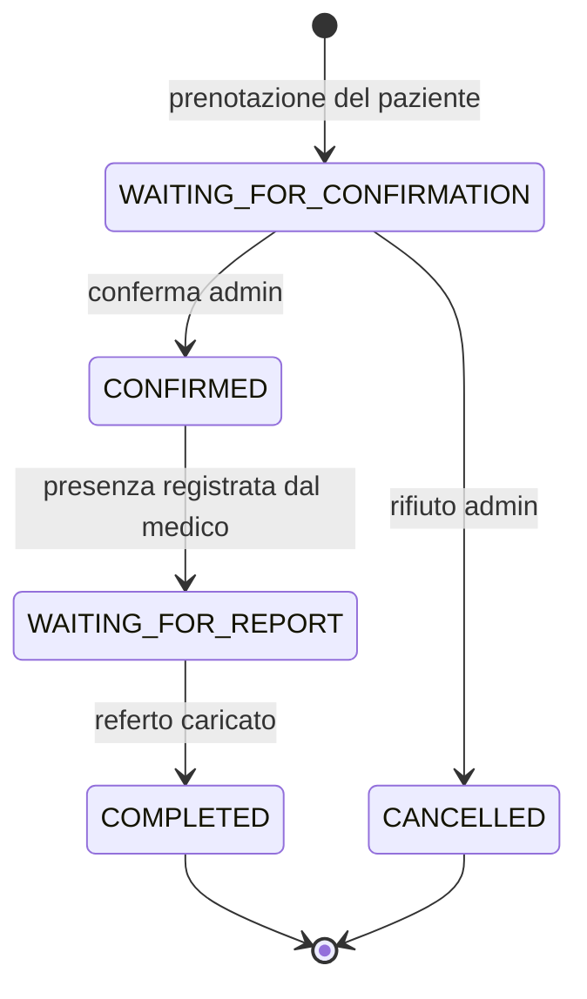
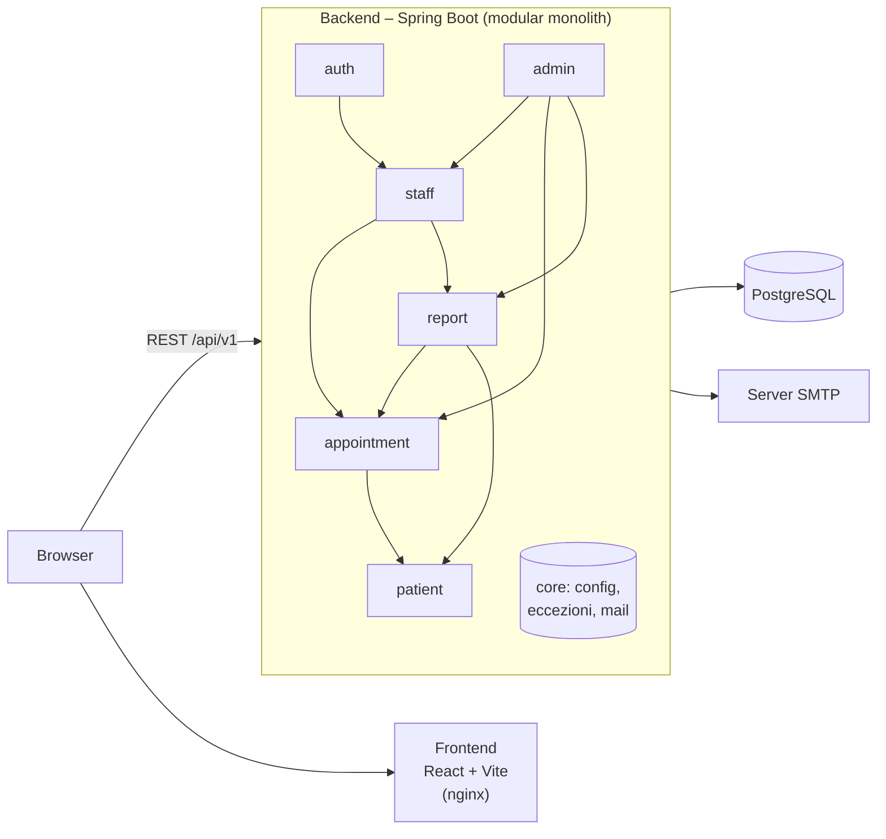
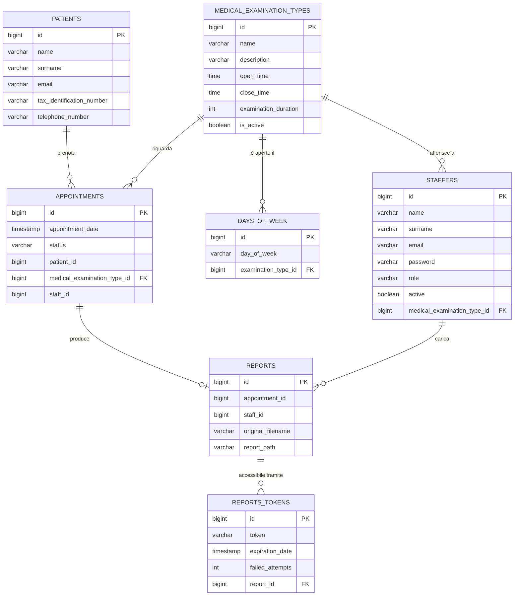

# Medical Center

Gestionale web per un centro medico: prenotazione online delle visite, gestione degli appuntamenti da parte di amministrazione e medici, caricamento dei referti e download sicuro da parte del paziente.

Progetto di tesi – Corso di laurea in Informatica, Università Telematica Pegaso.
Autore: Christian Esposito

    

---

## Indice
- [Funzionalità](#funzionalità)
- [Architettura](#architettura)
- [Modello dei dati](#modello-dei-dati)
- [Avvio rapido](#avvio-rapido)
- [Account demo](#account-demo)
- [Struttura del repository](#struttura-del-repository)
- [API](#api)
- [Test](#test)

---

## Funzionalità

**Paziente** (senza registrazione)
- prenota una visita scegliendo reparto, giorno e orario tra gli slot disponibili;
- riceve un'email di conferma della richiesta e, successivamente, di accettazione o rifiuto;
- scarica il referto tramite il link ricevuto via email, verificando la propria identità con il codice fiscale.

**Amministrazione**
- conferma o rifiuta le richieste di appuntamento;
- consulta statistiche (appuntamenti per reparto, per mese, per giorno);
- gestisce il personale medico (abilitazione/disabilitazione) e i reparti;
- reinvia i referti ai pazienti.

**Medico**
- visualizza gli appuntamenti futuri e passati del proprio reparto;
- registra la presenza del paziente;
- carica il referto in PDF, che viene inviato automaticamente al paziente.

### Ciclo di vita di un appuntamento



Le transizioni di stato sono atomiche (`UPDATE ... WHERE status = :atteso`): due operazioni concorrenti sullo stesso appuntamento non possono portarlo in uno stato incoerente.

### Download sicuro dei referti
Il link inviato al paziente contiene un token con scadenza. Per scaricare il file il paziente deve inserire il proprio codice fiscale; dopo 3 tentativi errati il token viene bloccato.

---

## Architettura



Il backend è un **modular monolith**: un'unica applicazione Spring Boot suddivisa in moduli di dominio con confini espliciti.

| Modulo | Responsabilità |
|---|---|
| `patient` | anagrafica dei pazienti |
| `appointment` | reparti/tipi di visita, calcolo degli slot, prenotazioni e stati |
| `report` | caricamento, archiviazione e download dei referti, token di accesso |
| `staff` | personale medico e operatività del medico |
| `auth` | autenticazione JWT |
| `admin` | funzioni di amministrazione e statistiche |
| `core` | configurazione, gestione centralizzata delle eccezioni, layout e invio email |

Ogni modulo espone verso gli altri **solo** il proprio package `api` (interfacce *Facade* e DTO di integrazione); entity, repository e service restano interni. Le dipendenze tra moduli sono acicliche, come mostrato nel diagramma.

---

## Modello dei dati



I riferimenti tra tabelle di moduli diversi (es. `appointments.patient_id`) sono gestiti a livello applicativo tramite le API dei moduli, senza chiavi esterne, per mantenere i moduli disaccoppiati.

---

## Avvio rapido

**Prerequisiti:** Docker e Docker Compose.

```bash
git clone https://github.com/zuzzorellone/pegaso_project_work.git
cd pegaso_project_work
cp .env.example .env          # i valori di default funzionano per la demo
docker compose up -d --build
```

| Servizio | Indirizzo |
|---|---|
| Frontend | http://localhost:5173 |
| Backend (API) | http://localhost:8080/api/v1 |
| PostgreSQL | localhost:9999 |

Al primo avvio il database viene creato e popolato automaticamente con dati di esempio (`db/init/init.sql`). Lo script si rifiuta di girare su un database già popolato.

Per ripartire da un database pulito:
```bash
docker compose down -v && docker compose up -d --build
```

### Invio email (opzionale)
Senza configurazione SMTP l'applicazione funziona normalmente; le email semplicemente non vengono inviate. Per abilitarle, valorizzare nel `.env` le variabili `SPRING_MAIL_*` (es. con un account Gmail e una *password per le app*).

### Sviluppo senza Docker
```bash
# database
docker compose up -d postgres
# backend (richiede JDK 25)
cd backend && ./mvnw spring-boot:run
# frontend (richiede Node 20+)
cd frontend && npm install && npm run dev
```

---

## Account demo

Tutti gli account hanno password **`Password123!`**.

| Ruolo | Email | Reparto |
|---|---|---|
| Amministratore | `admin@example.com` | – |
| Amministratore | `segreteria@example.com` | – |
| Medico | `laura.bianchi@example.com` | Cardiologia |
| Medico | `giorgio.ferri@example.com` | Dermatologia |
| Medico | `paolo.ricci@example.com` | Analisi del sangue |
| Medico | `sara.colombo@example.com` | Radiologia |
| Medico | `francesca.conti@example.com` | Oculistica |
| Medico | `matteo.galli@example.com` | Ortopedia |

I dati di esempio comprendono 12 pazienti fittizi e appuntamenti generati **relativamente alla data di avvio** (dalla settimana precedente alla successiva), in tutti gli stati del ciclo di vita: la demo mostra sempre richieste da confermare, visite di oggi e visite passate in attesa di referto.

Per provare il download di un referto come paziente: dalla dashboard del medico caricare un PDF su una visita passata, quindi aprire il link di download ricevuto e inserire il codice fiscale del paziente (es. `RSSMRA80A01H501U` per Mario Rossi).

---

## Struttura del repository

```
.
├── backend/                 Spring Boot (Java 25, Maven)
│   └── src/main/java/esposito/medicalCenter/
│       ├── admin/  appointment/  auth/  core/  patient/  report/  staff/
├── frontend/                React 19 + Vite
│   └── src/
│       ├── api/             client HTTP verso il backend
│       ├── components/      componenti condivisi (navbar, rotte protette, …)
│       ├── pages/           pagine dell'applicazione
│       └── styles/
├── db/init/                 schema e dati di esempio del database
├── docker-compose.yml
└── .env.example
```

---

## API

Tutte le API sono sotto `/api/v1`.

| Area | Endpoint principali | Accesso |
|---|---|---|
| Prenotazioni | `POST /appointments`, `GET /appointments/bookedDates`, `GET /appointments/availableTimes` | pubblico |
| Reparti | `GET /medical-examination-types` · `POST/PUT /medical-examination-types` | lettura pubblica · modifica `ADMIN` |
| Referti | `GET /public/reports/download` | token + codice fiscale |
| Autenticazione | `POST /auth/login` · `POST /auth/register` | pubblico · `ADMIN` |
| Medico | `/staff/me/appointments/...` (presenza, caricamento e reinvio referto) | utente autenticato |
| Amministrazione | `/admin/appointments/...`, `/admin/doctors/...`, `/admin/reports`, `/admin/stats` | ruolo `ADMIN` |

---

## Test

```bash
cd backend && ./mvnw test
```

I test coprono le regole di business dei moduli (calcolo degli slot disponibili, transizioni di stato degli appuntamenti, download dei referti, gestione dei pazienti e del personale) e la generazione delle email.
